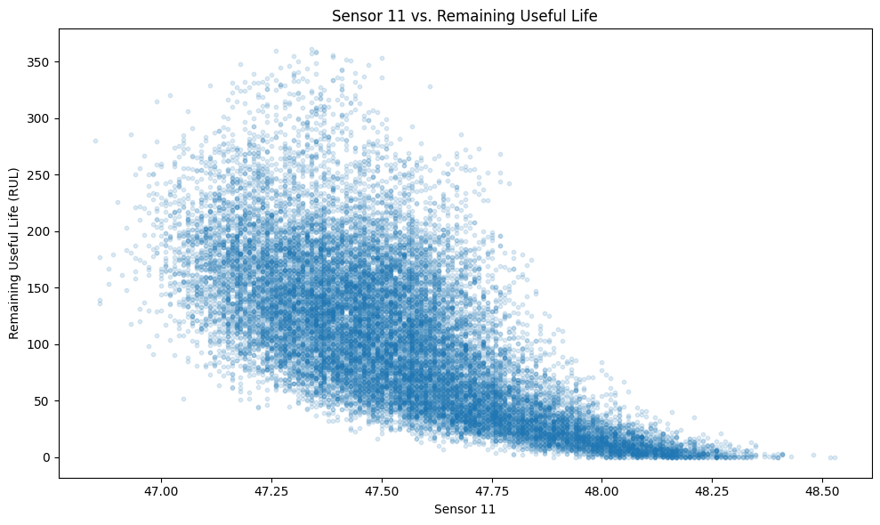
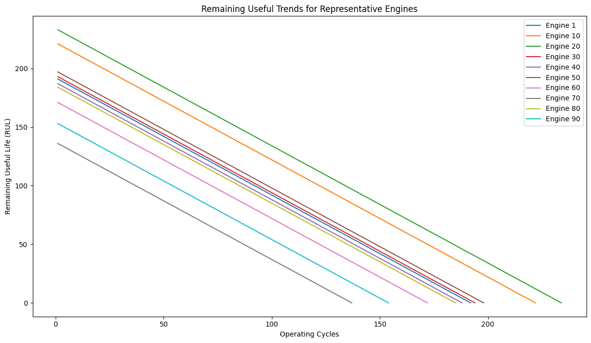

# Aircraft Engine Predictive Maintenance Analysis

## Project Overview

This project examines aircraft engine degradation using NASA's simulated C-MAPSS FD001 turbofan engine dataset. The analysis evaluates engine operating cycles, sensor measurements, and remaining useful life (RUL) to identify patterns associated with equipment deterioration.

Using Python, Pandas, and data visualization techniques, the project explores relationships between engine sensor behavior and remaining operational life across 100 simulated engines and 20,631 observations.

The objective is to demonstrate how equipment condition data can support reliability analysis, maintenance planning, and the development of future predictive maintenance models.

**Project Scope:** Exploratory data analysis, sensor correlation analysis, RUL calculations, and degradation visualization. This project does not claim to have trained or validated a predictive RUL model.

## Explore the Project

| Project Component | Description |
|---|---|
| [Python Analysis Notebook](analysis/Engine%20Data.ipynb) | Exploratory analysis, RUL calculations, and sensor relationships |
| [Analysis Results](results/README.md) | Dataset validation, correlations, and maintenance recommendations |
| [Visualizations](visualizations/README.md) | Seven charts illustrating engine behavior and degradation |
| [Dataset](data/README.md) | NASA C-MAPSS FD001 training data |
| [Analysis Documentation](analysis/README.md) | Notebook setup and reproduction instructions |
| [Project Report](documentation/AIRCRAFT%20ENGINE%20PREDICTIVE%20MAINTENANCE%20ANALYSIS-3.docx) | Detailed project documentation |

## Featured Visualizations

### Sensor 11 vs. Remaining Useful Life

### Representative Engine RUL Trends

These charts illustrate relationships between sensor behavior, engine operating cycles, and calculated remaining useful life in simulated turbofan engines.

## Business Problem

Aircraft and other complex mechanical systems require effective maintenance strategies to reduce unexpected failures, improve maintenance planning, and maximize equipment availability.

Predictive maintenance uses equipment data to identify patterns that may indicate degradation before a failure occurs.

This project applies that approach to aircraft engine data.

## Dataset

The analysis uses the NASA C-MAPSS FD001 dataset.

The dataset contains simulated aircraft engine run-to-failure data with multiple sensor measurements collected throughout each engine’s operating life.

### Dataset Summary

- **Dataset:** NASA C-MAPSS FD001 (simulated turbofan engines)
- **Engines:** 100
- **Observations:** 20,631
- **Columns:** 26
- **Total engine cycles (sum of cycle values):** 2,244,815
- **Missing values:** 0
- **Operating settings:** 3
- **Sensor measurements:** 21

## Analysis Performed

The analysis examined:

* Engine operating cycles
* Sensor behavior over time
* Remaining useful life
* Sensor-to-RUL relationships
* Degradation patterns
* Variables that may provide useful predictive-maintenance indicators

Python and data-analysis techniques were used to explore and interpret the data.

## Key Findings

Several variables showed relatively strong relationships with remaining useful life.

### Stronger Negative Relationships

Variable	Correlation with RUL
Time in cycles	-0.736
Sensor 11	-0.696
Sensor 4	-0.679
Sensor 15	-0.643
Sensor 2	-0.606
Sensor 17	-0.606
Sensor 3	-0.585

### Stronger Positive Relationships

Variable	Correlation with RUL
Sensor 12	+0.672
Sensor 7	+0.657
Sensor 21	+0.636
Sensor 20	+0.629

These relationships indicate that several sensor measurements change in ways associated with remaining useful life and may be useful for further predictive-maintenance modeling.

## Project Structure

'''text
aircraft-engine-predictive-maintenance/
├── analysis/
'''
│   ├── Engine Data.ipynb
'''
│   └── README.md
'''
├── data/
│   ├── train_FD001.txt
│   ├── RUL_FD001.txt
│   └── README.md
├── documentation/
│   ├── AIRCRAFT ENGINE PREDICTIVE MAINTENANCE ANALYSIS-3.docx
│   └── README.md
├── results/
│   └── README.md
├── visualizations/
│   ├── Sensor_11_vs_RUL.png
│   ├── Sensor_15.png
│   ├── Sensor_4.png
│   ├── distribution.png
│   ├── remaining.png
│   ├── representative.png
│   ├── top_10.png
│   └── README.md
├── .gitignore
└── README.md

## Results

The analysis identified sensor variables that demonstrated meaningful relationships with remaining useful life.

These findings can support future predictive models designed to estimate RUL and identify potential degradation before equipment failure.

The results are documented in the Results folder.

## Visualizations

The Visualizations folder contains charts created during the analysis to illustrate:

* Sensor relationships with RUL
* Engine degradation patterns
* Operating-cycle behavior
* Other supporting analysis results

## Maintenance Applications

The analysis demonstrates how sensor data can support:

* Condition-based maintenance
* Predictive maintenance
* Early identification of degradation
* Maintenance planning
* Reduction of unexpected equipment downtime
* Data-driven maintenance decisions

## Tools & Skills

### Technical Skills

* Python
* Pandas
* Matplotlib
* Data Cleaning
* Exploratory Data Analysis
* Correlation Analysis
* Data Visualization
* Predictive Maintenance
* Remaining Useful Life Analysis

### Industry Knowledge

* Aircraft and engine systems
* Mechanical maintenance
* Preventive maintenance
* Equipment troubleshooting
* Reliability concepts
* Manufacturing and industrial equipment

## Documentation

The complete project report is available in the Documentation folder.

The analysis notebook is available in the Analysis folder.

## Conclusion

This project demonstrates the use of data analytics to examine aircraft engine degradation and remaining useful life.

The analysis combines technical maintenance knowledge with data analytics to identify patterns that could support more proactive maintenance strategies.

⸻

Author: Harold Wanton
